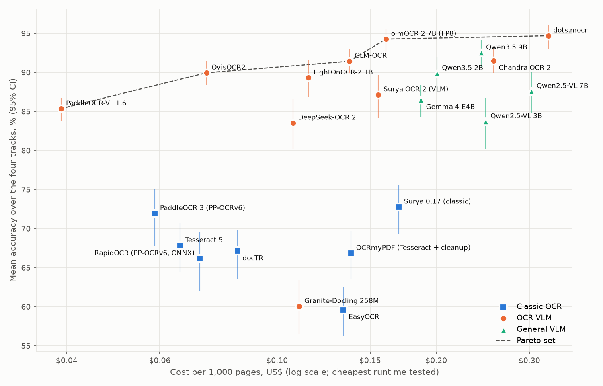
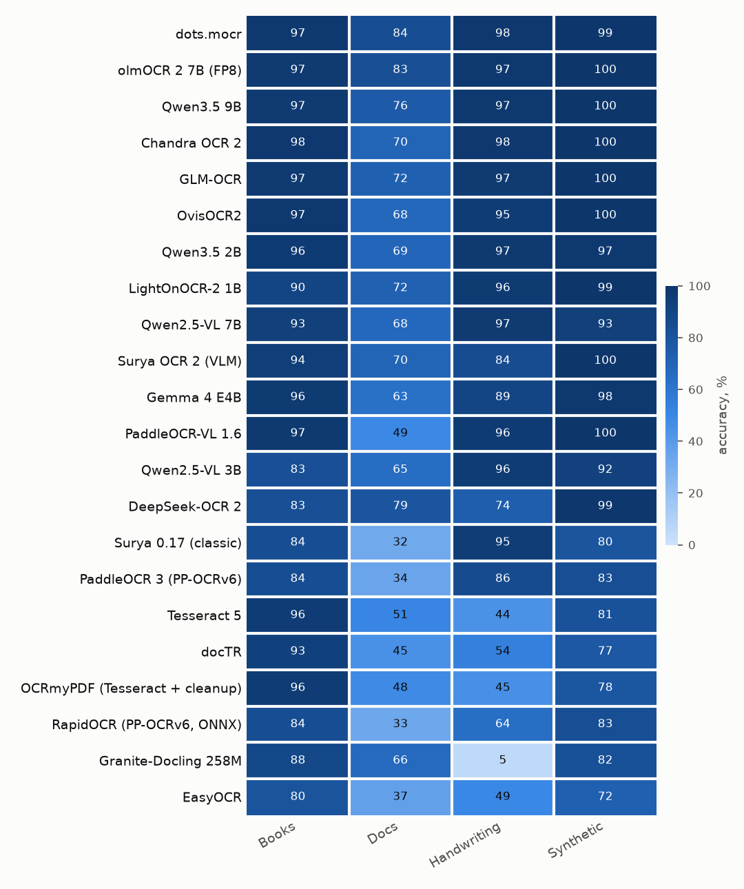
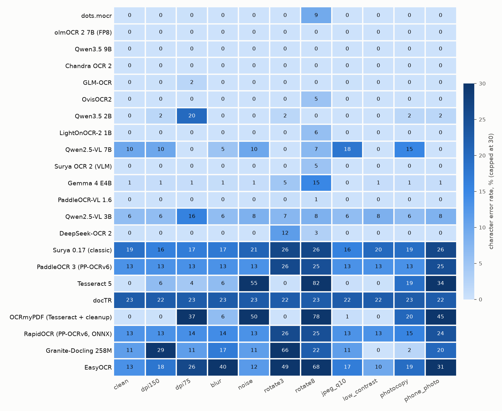
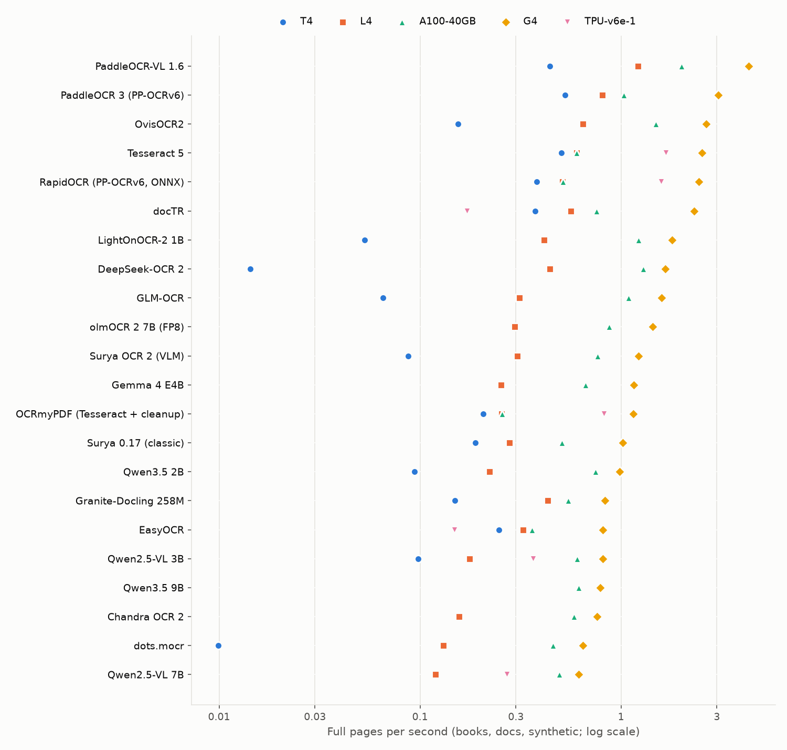

# Which Open OCR Engine Should I Use?

*Testing four common pieces of advice about reading text from images against 22 free engines, four kinds of material with known answers, and five rented Google Colab machines.*


Optical character recognition (OCR) turns a picture of text into text a computer can search. For decades it was done by specialised programs such as Tesseract. In the last two years, AI models that read images and write text have been trained to do it as well, and several are free to download. Four pieces of advice come up again and again when people discuss choosing an OCR system: general-purpose AI models such as Qwen and Gemini can do OCR; PaddleOCR, dots, and Surya give a good balance of accuracy and cost at large scale; large collections need pipelines built for their material; and results depend on the type of material.

I wanted to know whether that advice holds, and which of the free engines I could run myself on rented machines give the most accuracy for the money. So I chose 22 engines, four kinds of material whose correct text is known, and five Google Colab machines, and measured how accurately, how fast, and at what cost each engine reads.

## What I found

1. **The AI models are much more accurate than the traditional programs.** 14 of the 15 AI models scored higher on average than the best traditional program. The best AI model, dots.mocr, averaged 94.7%; the best traditional program, Surya 0.17, 72.8%. The traditional programs read old books well but fail on handwriting and on pages with columns or tables.
2. **A general-purpose AI model does nearly as well as one trained only for documents.** Qwen3.5-9B came third of 22 at 92.5%, and its range overlaps with the best model's.
3. **Which engine is best depends on the material.** Among the AI models, the order on old books and the order on modern documents are almost unrelated. The largest failures each came from one property of the material: two columns, a decorative header that made two models repeat themselves, and handwritten lines, on which one model wrote almost nothing and others added text that was not on the page.
4. **Cost differs by about eight times among the good engines.** Reading a million pages would cost about \$39 with the cheapest accurate engine, PaddleOCR-VL, and about \$326 with the most accurate, dots.mocr. Engines a few points less accurate cost between an eighth and a half as much as dots.mocr.
5. **A mid-priced machine, the L4, is usually the cheapest per page.** The fastest, the G4, read pages 3.6 to 5.3 times faster but costs five times as much per hour. Google's TPU cost 25–38% more per page than the cheapest graphics card and slowed down sharply when every image had a different size.

In practice: for every kind of material tested, the most accurate engines were AI models, and a mid-priced rented graphics card was usually the cheapest way to run them. Which model is best depends on the material, so a test on a sample of the real material should come first.

## 1. The engines

The seven traditional, or *classic*, engines split the job into stages: find the lines or words on the page, then recognise the characters in each. Tesseract, begun at Hewlett-Packard and released as open source in 2005 ([Smith 2007](#references)), runs on an ordinary processor. OCRmyPDF ([Barlow 2026](#references)) wraps Tesseract in steps that straighten, clean, and rotate each page first. PaddleOCR's PP-OCRv6 models ([Zhang et al 2026b](#references)) find text regions with one neural network and read them with a second, and RapidOCR ([RapidAI 2021](#references)) runs the smaller "small" versions of these models, converted to the ONNX format, through a different runtime ([RapidOCR 3.9.0 release notes](https://github.com/RapidAI/RapidOCR/releases/tag/v3.9.0)). EasyOCR ([JaidedAI 2024](#references)) and docTR ([Mindee 2021](#references)) work the same way with other networks. Surya 0.17 ([Paruchuri 2025](#references)) is a line-by-line OCR toolkit from the company Datalab.

The other 15 engines are *vision-language models* (VLMs), AI models that read an image and write text. Ten are trained specifically to transcribe documents, and five are general models:

| Model | Size (billion parameters) | What it is |
|---|---|---|
| dots.mocr ([rednote 2026](#references)) | 3.0 | Follows the design of dots.ocr ([Zheng et al 2026](#references)); its plain-text mode leaves out page headers and footers by design |
| olmOCR 2 ([Poznanski et al 2025b](#references)) | 8.3 | Qwen2.5-VL-7B trained with rewards computed from unit tests; run in its FP8 version |
| Chandra OCR 2 ([Datalab 2026a](#references)) | 5.3 | Datalab's document model |
| Surya OCR 2 ([Datalab 2026b](#references)) | 0.69 | Datalab's Surya 2 model, a single VLM that newer versions of the Surya toolkit run |
| GLM-OCR ([ZAI 2026](#references)) | 1.33 | Its software kit runs a layout-detection model first |
| PaddleOCR-VL 1.6 ([Zhang et al 2026a](#references)) | 0.96 | Its official system runs a layout model first, then the VLM on each region |
| OvisOCR2 ([ATH-MaaS 2026](#references)) | 0.85 | Qwen3.5-0.8B trained further for OCR |
| LightOnOCR-2 ([Taghadouini et al 2026](#references)) | 1.0 | Reads the whole page in one step |
| DeepSeek-OCR 2 ([Wei et al 2026](#references)) | 3.4 | Compresses the page into 256 to 1,120 image tokens, then decodes with a 3-billion-parameter mixture-of-experts language model |
| Granite-Docling ([IBM 2025](#references)) | 0.26 | Writes the DocTags markup of SmolDocling ([Nassar et al 2025](#references)), which a library converts to text |
| Qwen3.5 [2B](https://huggingface.co/Qwen/Qwen3.5-2B) and [9B](https://huggingface.co/Qwen/Qwen3.5-9B) ([Qwen 2026](#references)) | 2.3, 9.7 | General |
| Gemma 4 E4B ([Gemma Team et al 2026](#references)) | 8 | General |
| Qwen2.5-VL 3B and 7B ([Bai et al 2025](#references)) | 3.8, 8.3 | General |

Sizes are the parameter counts of the published weight files on Hugging Face; some model cards state rounded or smaller figures.

The general models got one plain instruction to transcribe the page; the OCR models got the prompt and settings from their model cards. Every model read whole pages. I tested only models whose weights can be downloaded, because the question was what runs on rented hardware without per-page fees, so API models such as Gemini, GPT, and Claude are not included.

## 2. Four kinds of material with known answers

Each engine read four sets of material, called *tracks*:

- **Old books:** 50 pages of natural-history books printed between 1708 and 1913, in English, French, German, and Latin, from the FineBooks ground truth ([Majstorovic & van Strien 2026](#references); [FineBooks 2026a](#references)).
- **Modern documents:** 50 PDFs from olmOCR-bench ([Poznanski et al 2025a](#references)), which scores output with automatic unit tests: that a sentence is present, that a page header is absent, that a table cell is under the right heading, and so on.
- **Handwriting:** 60 single lines of English handwriting from the IAM database ([Marti & Bunke 2002](#references); [Teklia 2024](#references)).
- **Damaged pages:** five clean printed pages, each also made worse in ten ways (lower resolution, blur, speckle, rotation, heavy compression, low contrast, a photocopy look, a simulated phone photograph), 55 pages in all.

For books, handwriting, and damaged pages, accuracy is the share of characters read correctly: one minus the *character error rate* (CER), the number of single-character changes needed to turn the output into the correct text, divided by the length of the correct text. A model that repeats itself until it stops can have a CER of several hundred percent on one page, so I capped each page at 100%, which counts it as one complete failure. For modern documents, accuracy is the share of unit tests passed.

The machines, or *runtimes*, were four with NVIDIA graphics cards (T4, L4, A100, and G4, from \$0.119 to \$0.870 an hour) and one with a Google TPU v6e chip. Accuracy did not depend on the machine (a median difference of 0.04 points), so every accuracy figure comes from the G4, the only runtime on which all 22 engines read every page. Cost per 1,000 pages is the hourly price divided by reading speed.

## 3. The four claims, and how I judged them

I chose the four claims before any engine ran, but I did not write down in advance what would count as support. The criteria below were written after all the runs were complete, so they are my reading of the results, not tests fixed beforehand.

| Claim | What I counted as support | Result |
|---|---|---|
| 1. General VLMs can do OCR | The ranges of the best general VLM and the best OCR VLM overlap | **Yes,** for open models of 2–9 billion parameters. Qwen3.5-9B 92.5% (90.6–94.1), dots.mocr 94.7% (93.0–96.1): within two points on books, handwriting, and damaged pages, eight points lower on documents. Qwen3.5-2B is seventh of 22. Gemini was not tested. |
| 2. PaddleOCR, dots, and Surya balance accuracy and cost at scale | No other engine is both cheaper and more accurate (the dashed line in Figure 1) | **Partly.** True of PaddleOCR-VL, the cheapest engine. dots.mocr is on the line as its most accurate and most expensive point, not as a balance. Surya OCR 2 (87.1%, \$0.156) is less accurate and more expensive than both GLM-OCR and OvisOCR2. The classic PaddleOCR and Surya 0.17 are below every VLM but one. |
| 3. Large collections need pipelines built for the material | No pipeline was built, so this could not be tested as stated | **Not tested.** Consistent with the results: every large failure was specific to the material and to how the engine was used, and the two engines whose official systems include a layout stage lost most on the tests that stage addresses. |
| 4. Results depend on the type of material | Rank agreement between tracks is low, or the best engine differs by track | **Yes.** Among VLMs, the rank correlation between books and documents is 0.22, and the best engine differs by track. Surya 0.17 scores 95.2% on handwriting and 32.3% on documents. |

## 4. Accuracy against cost



*Figure 1. Mean accuracy over the four tracks (G4 run, 95% bootstrap range) against cost per 1,000 full pages on each engine's cheapest Colab runtime (log scale). The dashed line joins the engines for which no other engine is both cheaper and more accurate. Data: `figures/data.json`.*

Mean accuracy ranges from 59.6% (EasyOCR) to 94.7% (dots.mocr, 95% range 93.0 to 96.1). olmOCR 2 (94.3%) and Qwen3.5-9B (92.5%) come next, and I could not tell these three apart. Chandra OCR 2, GLM-OCR, OvisOCR2, and Qwen3.5-2B form a second group whose ranges overlap each other and the third-placed model. Every VLM except Granite-Docling scored higher than every classic engine.

Five engines are on the dashed line: PaddleOCR-VL (\$0.039 per 1,000 pages, 85.4%), OvisOCR2 (\$0.074, 90.0%), GLM-OCR (\$0.137, 91.4%), olmOCR 2 (\$0.161, 94.3%), and dots.mocr (\$0.326, 94.7%). Moving from olmOCR 2 to dots.mocr doubles the cost for a difference of 0.4 points, inside both ranges.

## 5. The best engine depends on the material



*Figure 2. Accuracy by track (G4 run), engines in order of mean accuracy. Books, handwriting, and synthetic: 1 − CER; docs: olmOCR-bench pass rate. Data: `figures/data.json`.*

Chandra OCR 2 was best on books (98.0%) and made no errors on any of the 55 damaged pages. dots.mocr was best on modern documents (84.2%) and handwriting (98.0%). Much of the agreement between tracks comes from the gap between classic engines and VLMs; among the VLMs alone, the order on books and the order on documents are almost unrelated. PaddleOCR-VL is fourth on books (97.0%) and last of the VLMs on documents (48.8%). DeepSeek-OCR 2 is third on documents (78.9%) and second-last of the VLMs on handwriting (73.6%). Tesseract is within 2.3 points of the best engine on books and scores 43.9% on handwriting. The next four sections give the reasons.

## 6. What went wrong on old books

Three effects account for nearly all the error on this track.

**A page in two columns.** One English book, *Conchologia Iconica*, prints a Latin description beside its English translation. On its nine pages, PaddleOCR, RapidOCR, Surya 0.17, and EasyOCR have a CER between 70% and 78%, against 6.1% for Tesseract and 0.9% for dots.mocr. Their output alternates between the columns line by line. Here is RapidOCR:

```text
Species 370. (Mus. Cuming.)
what rounded, smooth or concentrically striated,
BuLIMUs MERIDIONALIs. Bul. testá ovato-conicá, um-
columella reflected, aperture small, lip simple; pale
bilicatá, tenui, diaphaná, anfractibus septem, obliquè
```

These engines return text lines from top to bottom without grouping them into columns. Tesseract finds the columns first, which is why it scores 95.7% on books where PaddleOCR, RapidOCR, and Surya 0.17 score about 84%. DeepSeek-OCR 2 and Qwen2.5-VL-3B also fail on this book. This book is also one of the six FineBooks books, but FineBooks says its leaderboard does not measure multi-column layouts ([Majstorovic & van Strien 2026](#references)), and the leaderboard gives scores by language, not by book ([FineBooks 2026b](#references)), so it does not show this effect on its own.

**Characters no engine can produce.** In the Latin book, the reference encodes the printer's joined letters (ligatures) as private code points that only the transcribers' font can display, and Greek quotations as a placeholder character. These are 3.5% of the reference characters on the sampled Latin pages, and every one costs at least one error. The best engine on Latin pages has a CER of 8.5%, consistent with a floor of 4–7% from the reference alone.

**Repetition on a decorative header.** The Latin book's running head is a page number between printer's ornaments. On three of the eight Latin pages, LightOnOCR-2 writes the ornaments as mathematical symbols and repeats them until its length limit, and on a fourth it appends commentary; Surya OCR 2 repeats a symbol there on two pages. So LightOnOCR-2, within 2 points of the best engine on every other language, scores 89.8% on books.

**Agreement with FineBooks.** On the nine engines both studies tested when this post was first written, the order on books agrees closely with the FineBooks leaderboard ([FineBooks 2026b](#references)), with a rank correlation of 0.77. Chandra OCR 2 was added to the leaderboard on 30 October 2026 and is not in this comparison. The two large differences come from LightOnOCR-2's repetition, which FineBooks reports separately instead of counting as errors, and from DeepSeek-OCR 2 on the two-column book. That book is also in the FineBooks set, so this study does not explain the second difference.

## 7. Tables, headers, and columns in modern documents

Two kinds of test account for most of the spread on this track.

**Tables.** The table tests need the output to contain a table. Every classic engine writes plain lines, and so does PaddleOCR-VL with its whole-page prompt, so they pass none of these tests; GLM-OCR passes 32%. Both models are designed to run inside a pipeline in which a layout model finds the tables first ([Cui et al 2025](#references); [ZAI 2026](#references)), so PaddleOCR-VL's 48.8% on documents describes whole-page use, not the product.

**Headers and footers.** These tests pass only if the page header and footer are *absent*, because olmOCR-bench treats them as content a text extraction should leave out. Models trained to leave them out pass: dots.mocr ([rednote 2026](#references)), olmOCR 2, DeepSeek-OCR 2, and Granite-Docling at 95%, and GLM-OCR at 100%. Models that transcribe everything fail: OvisOCR2 (14%) and LightOnOCR-2 (18%). LightOnOCR's own report of its olmOCR-bench score leaves this category out ([Taghadouini et al 2026](#references)). This is a disagreement about the task, not about reading: the books reference includes running heads, so the behaviour that passes these tests loses characters on books.

The two-column failure appears again: PaddleOCR and RapidOCR pass 6% of the multi-column tests, against 71% for Tesseract. Old scans are hard for every engine; none passes more than 37% of their tests.

## 8. Handwriting

The 60 lines separate the engines more than any other track, from 98.0% (dots.mocr) to 4.7% (Granite-Docling). Eleven VLMs and the classic Surya 0.17 score between 95% and 98%. Four VLMs score well below the rest, each for a different reason, checked against the IAM reference:

- **Granite-Docling (4.7%)** returns no text for 56 of the 60 lines. Its card does not mention handwriting ([IBM 2025](#references)). I infer, but could not confirm, that it marks each line as a picture rather than text.
- **DeepSeek-OCR 2 (73.6%)** returns nothing for 4 lines and, on others, writes a fluent sentence that is not on the page (below).
- **Surya OCR 2 (84.5%)** often reads a line correctly and then continues with an invented next line.
- **Gemma 4 E4B (89.2%)** often stops partway through a line.

```text
reference:  simple and coherent plan. To understand how
output:     had been able to achieve their goals, it is necessary to understand how they had achieved them.
```

Apart from Surya 0.17 and PaddleOCR (85.9%), the classic engines score 44–64% on handwriting.

## 9. Damaged pages



*Figure 3. CER (%) by degradation level on the synthetic track, five pages per level, G4 run. Colour is capped at 30%. Data: `figures/data.json`.*

Eleven of the 15 VLMs have a CER below 1% at nine or more of the eleven levels; their largest errors are in a few cells, such as Gemma 4 at 8° rotation (15%). Tesseract is error-free on clean pages and fails on speckle (55%), 8° rotation (82%), and the phone photograph (34%), and OCRmyPDF's straightening step does not help at 8° (78%). PaddleOCR, RapidOCR, Surya 0.17, and docTR have a nearly constant error of 13–23% at every level, including clean pages, which comes from particular base pages, not from the damage.

The leaderboard's automatic "most robust" label went to Qwen2.5-VL-7B, whose error is *lower* on damaged pages than on clean ones. That is not robustness: there is one page per layout at each level, and whether it fails on its two hard pages varies from level to level regardless of the damage. With five pages per level, only engines that read the clean pages without error can show robustness. Of those, Chandra OCR 2 read all 55 pages with no errors, and olmOCR 2 and Qwen3.5-9B had a CER below 0.01%. These are the most robust engines in this sample.

## 10. Speed and cost on each machine



*Figure 4. Throughput in full pages per second (books, docs, synthetic) for every engine on every runtime on which it ran (log scale). Engines in order of throughput on the G4. Data: `figures/data.json`.*

- **The G4 is the fastest runtime for every VLM.** The L4 reads at about a quarter of its speed, but the G4 costs 5.1 times as much per hour, so the L4 is the cheapest runtime for 11 of the 22 engines, and the A100 for 7.
- **Classic engines follow the number of processor cores, not the graphics card.** Tesseract reads 0.50 pages per second on the T4's 8-core host and 2.53 on the G4's 48 cores.
- **The T4 is too slow for most VLMs.** It lacks bfloat16, a number format some of these models need, and FlashAttention-2 ([Dao 2023](#references)), the attention code that the serving software vLLM ([Kwon et al 2023](#references)) uses by default on the A100 and L4, does not support it ([FlashAttention README](https://github.com/Dao-AILab/flash-attention); [vLLM attention backends](https://docs.vllm.ai/en/latest/design/attention_backends/)). dots.mocr cost \$3.33 per 1,000 pages there; only PaddleOCR-VL remains practical, at \$0.074.
- **The TPU is fast for full pages and slow for varied sizes.** Of the VLMs it ran only Qwen2.5-VL 3B and 7B. It matched the G4 on a single full page, but in batches cost 25% and 38% more per page than the cheapest graphics card, and on handwriting took 13–21 seconds per line, against 0.1 seconds on the G4. The TPU software is built on JAX ([vLLM 2026b](#references)), which compiles a separate program for each new input shape ([JAX 2026](#references)), and every handwritten line has a different width.

## 11. What could be wrong

- **Small samples.** 50–60 items per track give 95% ranges about 2 points wide for the best engines on books, handwriting, and damaged pages, and about 12 points wide on documents. Most differences among the top seven engines are inside these ranges.
- **Six books.** With 8 or 9 pages from each, one unusual book moves an engine's score by several points, although the order agrees with FineBooks, which scores all 2,165 pages.
- **Whole-page prompts.** PaddleOCR-VL and GLM-OCR are designed to run behind a layout model, and dots.mocr, Chandra, and Surya OCR 2 have layout modes I did not use.
- **Part of olmOCR-bench.** The mathematics tests, 48% of the benchmark, were left out.
- **Conventions in the references.** The books references include page headers, which the document tests penalise, and I did not ignore capital letters where FineBooks does. Both choices affect engines differently.
- **Training data.** IAM and olmOCR-bench are public, and the damaged pages use famous passages; a model that has memorised Darwin could reproduce him from a page it cannot read, so that track may overstate robustness. The FineBooks reference was published in August 2026, after most of these models, although the books were already available as page images and older OCR.
- **Randomness.** LightOnOCR-2, dots.mocr, and olmOCR 2 sample with a little randomness, as their cards recommend, so results can vary slightly between runs despite fixed seeds.
- **Prices.** The hourly rates come from a third party and the Colab interface, and they change; costs leave out loading (up to 11 minutes) and installation. Relative costs are more reliable than the amounts.
- **One software version.** All VLMs ran on vLLM 0.30. Speed on the T4 in particular may improve in later versions.

## 12. What I take from this

The first and fourth claims held. The second held for PaddleOCR-VL only: dots.mocr is the most accurate engine rather than a balanced one, and Surya OCR 2 is less accurate and more expensive than GLM-OCR and OvisOCR2. The third fits every large failure, but I built no pipeline, so it was not tested.

What I would use, after first checking a sample of my own material:

- **Old printed books:** OvisOCR2 or PaddleOCR-VL, 97% for \$0.04–0.07 per 1,000 pages on an L4. Chandra OCR 2 and dots.mocr score up to 0.7 points higher at 3.5 to 8.4 times the cost. Tesseract reads them at 95.7% without a graphics card and handles two columns.
- **Modern PDFs with tables and columns:** dots.mocr or olmOCR 2, or DeepSeek-OCR 2 at a third of the cost of dots.mocr; PaddleOCR-VL and GLM-OCR only with their layout pipelines.
- **English handwritten lines:** any of eleven VLMs or Surya 0.17, but not Granite-Docling, DeepSeek-OCR 2, Surya OCR 2, or Gemma 4 without more testing.
- **Badly damaged scans:** olmOCR 2, Chandra OCR 2, or Qwen3.5-9B.
- **No graphics card:** Tesseract, the most accurate engine on a CPU (67.8% on average, 95.7% on books), whose speed grows with the number of cores.
- **Machine:** an L4 for most VLMs, an A100 for the largest. A G4 finishes 3.6 to 5.3 times sooner at a similar or slightly higher cost per page. A T4 suits only PaddleOCR-VL and the classic engines.

Next I would run PaddleOCR-VL, GLM-OCR, and dots.mocr with their layout pipelines on the document track; pad images to a few fixed sizes on the TPU and run Gemma 4 E4B there; score all 2,165 FineBooks pages; add the mathematics tests of olmOCR-bench; and test full handwritten pages rather than single lines.

---

## Details for anyone who wants to check the work

### A. Data

Every track was sampled with seed 1234, and every page was converted to PNG before any engine saw it, so all engines received identical images.

- **Books** (50 pages; CC-BY 3.0). `finebooks/bhl-impact-gt` holds expert transcriptions of 2,165 pages from six Biodiversity Heritage Library volumes, made by the IMPACT and BHL-Europe projects ([FineBooks 2026a](#references)). Pages with fewer than 200 characters (plates, blanks) were dropped, then 8 or 9 pages were drawn from each volume: *Birds of Great Britain* and *Conchologia Iconica* (English), one German volume, Cuvier's *Histoire naturelle des poissons* (French), *Trudy Russkago entomologicheskago obshchestva* (French and German), and *Piscium querelae et vindiciae*, 1708 (Latin). The reference keeps the long s (ſ) and ligatures.
- **Modern documents** (50 PDFs; ODC-BY). Ten PDFs from each of five olmOCR-bench categories (headers and footers, long tiny text, multi-column, old scans, tables), with 292 category tests and one baseline test per page that checks for any output and for repetition at the end. The full benchmark has 7,010 tests ([Poznanski et al 2025a](#references)). PDFs were rendered at 2,048 pixels on the longest side, as olmOCR does for API models. The two mathematics categories were excluded because their tests need KaTeX in a headless Chromium browser, which the benchmark does not install, so this score is not comparable with published overall scores.
- **Handwriting** (60 lines; MIT, with IAM's own research terms). Random lines from the 2,915-line test split of `Teklia/IAM-line`, each 128 pixels high. The tokenised IAM transcriptions ("it 's a good start .") were detokenised.
- **Synthetic** (55 pages). Five base pages rendered at 300 DPI from public-domain passages (Darwin, Austen, Melville, Lincoln, and accented French and German): two prose pages, a two-column page, a table, and an invoice. Eleven levels: clean, 150 DPI, 75 DPI, blur, noise, 3° rotation, 8° rotation, JPEG quality 10, low contrast, photocopy, phone photograph. The ground truth is the rendered text.

### B. Engines, machines, and measurement

VLMs were served with vLLM 0.30 ([Kwon et al 2023](#references)) and Transformers 5.16, with prompts, sampling, and image sizes from each model card. Settings that differ from vLLM's defaults:

| Engine | Prompt or mode | Settings |
|---|---|---|
| Tesseract 5 | `--oem 1 --psm 3` (LSTM, automatic page segmentation), eng+fra+deu+lat | CPU, one process per core |
| OCRmyPDF 17 | Tesseract with `--deskew --clean --rotate-pages`, sidecar text | CPU |
| RapidOCR 3.9 | PP-OCRv6 small detection and recognition in ONNX Runtime | CPU |
| EasyOCR 1.7 | en, fr, de, la | GPU when present |
| docTR 1.1 | `fast_base` + `parseq` | GPU when present |
| PaddleOCR 3.7 | PP-OCRv6 medium | GPU only |
| Surya 0.17 | line OCR | GPU |
| PaddleOCR-VL 1.6 | `OCR:`, whole page | greedy |
| OvisOCR2 | the card's Markdown prompt | greedy; repeated tails trimmed as on the card |
| LightOnOCR-2 1B | image only | temperature 0.2, top-p 0.9, longest side 1,540 px |
| GLM-OCR | `Text Recognition:` | top-k 1, repetition penalty 1.1 |
| Granite-Docling | `Convert this page to docling.` | DocTags converted with docling-core |
| dots.mocr | `prompt_ocr` (plain text) | temperature 0.1 |
| DeepSeek-OCR 2 | `<|grounding|>Convert the document to markdown.` | n-gram repetition processor from the card |
| Chandra OCR 2 | the card's HTML prompt | greedy |
| Surya OCR 2 | full-page HTML mode | greedy |
| olmOCR 2 7B (FP8) | olmOCR's v4 prompt, text before image | temperature 0.1, longest side 1,288 px |
| Qwen3.5 2B and 9B | general prompt | greedy, thinking off |
| Gemma 4 E4B | general prompt | greedy, 1,120 image tokens |
| Qwen2.5-VL 3B and 7B | general prompt | greedy, at most 1.0 megapixels |

The general prompt: "Read all the text in the image. Transcribe it exactly as written, in natural reading order, as Markdown. Format tables as Markdown tables. Do not add any commentary." PaddleOCR is GPU only because on a CPU PaddlePaddle 3.3 requires its oneDNN acceleration to be disabled for these models, and it then read about 0.01 pages per second in a local test; RapidOCR runs the smaller PP-OCRv6 models on CPU hosts. Two registry models were not run, to keep sessions within budget: Nanonets-OCR2-3B (a Qwen2.5-VL-3B fine-tune whose card states no licence) and Qwen3-VL-8B (the predecessor of Qwen3.5-9B).

Each engine family has its own virtual environment (classic, Paddle, Surya, vLLM, and vLLM-TPU on Python 3.12, the only version vllm-tpu 0.30 builds for), because their dependencies conflict. Each engine runs in its own process group, killed afterwards, because in an early run a leftover vLLM worker held 12.7 GB of GPU memory and made every later model fail. Weights are deleted after each model to fit the Colab disk.

| Runtime | Accelerator | Memory | Host CPUs | Compute units per hour | US\$ per hour |
|---|---|---|---|---|---|
| T4 | Tesla T4 (Turing, no bfloat16) | 15 GB | 8 | 1.19 | 0.119 |
| L4 | L4 (Ada) | 22.5 GB | 12 | 1.71 | 0.171 |
| A100-40GB | A100 (Ampere) | 40 GB | 12 | 5.40 | 0.539 |
| G4 | RTX PRO 6000 Blackwell Server Edition | 95.6 GB | 48 | 8.71 | 0.870 |
| TPU v6e-1 | one TPU v6e chip | 32 GB | 44 | 4.08 | 0.408 |

Colab sells compute units at \$9.99 per 100 ([Google 2026](#references)) but does not publish a rate per runtime. The GPU rates are third-party measurements ([McCormick 2024](#references)); the TPU rate was read from the Colab resources panel. An engine runs on a runtime only if it fits in memory, the runtime supports bfloat16 when needed, and the engine's backend supports the runtime. On the T4, VLMs run in float16, except LightOnOCR-2 and Granite-Docling in float32: in float16 LightOnOCR-2 scored 0% in the smoke runs, reaching its token limit on every page, and Granite-Docling's card warns that on the T4, which lacks bfloat16, it outputs only exclamation marks unless it is run in float32 ([IBM 2025](#references)).

- **Accuracy.** Page CER is computed in *reading* mode, capped at 1, and averaged over pages. Reading mode strips Markdown, HTML, LaTeX, and model-specific tokens, applies Unicode NFKC, maps the long s to s, unifies quotation marks and dashes, and joins words hyphenated at line ends. FineBooks also reports a *diplomatic* mode, which counts a modern "s" written for a printed long s as an error. Unlike FineBooks, reading mode here does not fold case. The documents score is the mean of per-category pass rates, with the baseline test as a sixth category. The loop rate is the share of pages ending in a repeated sequence or at the token limit; the empty rate, the share with no output.
- **Speed.** One untimed warm-up page, then up to eight pages one at a time per track (latency), then all pages in batches (throughput, over the three full-page tracks; a handwriting line is about a twentieth of a page and is reported separately).
- **Cost.** Loading, from 0.2 seconds (Tesseract) to 11 minutes (Qwen3.5-2B on a T4), and installation are excluded.
- **Time budget.** 25 minutes of reading per engine and runtime, 45 or 60 for the slow sessions in the run log, plus 30 minutes for loading. The budget is shared between tracks, leftover time returns to tracks cut short, batches are sized to fit the time left, and an engine that runs out is reported as partial.
- **Statistics.** 95% percentile bootstrap over pages, 2,000 resamples; for documents, pages are resampled and category pass rates recomputed; the overall interval resamples each track independently. Rank agreement is Spearman's ρ.
- **Suspect results.** A result more than 25 points below the same engine's best on the same track on another runtime is marked suspect and excluded.
- **Reference runtime.** Across every complete track run on more than one runtime, the median spread was 0.04 points and the largest 4.3 points (Granite-Docling, synthetic). PaddleOCR's G4 figures come from its rerun (Details D).

### C. Full results

| # | Engine | Type | Books | Docs | Handwriting | Synthetic | Mean (95% CI) | \$ per 1,000 pages (runtime) |
|---|---|---|---|---|---|---|---|---|
| 1 | dots.mocr | OCR VLM | 97.5 | **84.2** | **98.0** | 99.1 | **94.7** (93.0–96.1) | 0.326 (A100) |
| 2 | olmOCR 2 7B | OCR VLM | 96.8 | 82.9 | 97.4 | 100.0 | 94.3 (92.6–95.6) | 0.161 (L4) |
| 3 | Qwen3.5 9B | general VLM | 96.8 | 76.0 | 97.3 | 100.0 | 92.5 (90.6–94.1) | 0.243 (A100) |
| 4 | Chandra OCR 2 | OCR VLM | **98.0** | 70.3 | 97.7 | **100.0** | 91.5 (90.0–93.0) | 0.257 (A100) |
| 5 | GLM-OCR | OCR VLM | 96.8 | 72.4 | 96.8 | 99.8 | 91.4 (89.9–93.0) | 0.137 (A100) |
| 6 | OvisOCR2 | OCR VLM | 97.3 | 67.6 | 95.3 | 99.5 | 90.0 (88.3–91.5) | 0.074 (L4) |
| 7 | Qwen3.5 2B | general VLM | 95.9 | 69.1 | 97.1 | 97.5 | 89.9 (87.5–91.9) | 0.201 (A100) |
| 8 | LightOnOCR-2 1B | OCR VLM | 89.8 | 71.8 | 96.3 | 99.5 | 89.3 (86.8–91.6) | 0.115 (L4) |
| 9 | Qwen2.5-VL 7B | general VLM | 93.1 | 67.5 | 96.5 | 93.2 | 87.6 (84.8–90.1) | 0.303 (A100) |
| 10 | Surya OCR 2 | OCR VLM | 94.4 | 70.2 | 84.5 | 99.5 | 87.1 (84.2–89.7) | 0.156 (L4) |
| 11 | Gemma 4 E4B | general VLM | 96.2 | 63.0 | 89.2 | 97.6 | 86.5 (84.3–88.4) | 0.187 (L4) |
| 12 | PaddleOCR-VL 1.6 | OCR VLM | 97.0 | 48.8 | 95.8 | 99.9 | 85.4 (83.7–86.7) | **0.039** (L4) |
| 13 | Qwen2.5-VL 3B | general VLM | 82.7 | 64.5 | 95.6 | 92.1 | 83.7 (80.2–86.7) | 0.248 (A100) |
| 14 | DeepSeek-OCR 2 | OCR VLM | 82.9 | 78.9 | 73.6 | 98.7 | 83.5 (80.2–86.6) | 0.107 (L4) |
| 15 | Surya 0.17 | classic | 83.9 | 32.3 | 95.2 | 79.6 | 72.8 (69.3–75.6) | 0.170 (L4) |
| 16 | PaddleOCR 3 (PP-OCRv6) | classic | 84.3 | 34.1 | 85.9 | 83.5 | 71.9 (67.8–75.1) | 0.059 (L4) |
| 17 | Tesseract 5 | classic | 95.7 | 50.7 | 43.9 | 81.0 | 67.8 (64.5–70.7) | 0.066 (T4) |
| 18 | docTR | classic | 92.6 | 44.8 | 53.7 | 77.5 | 67.1 (63.6–69.9) | 0.084 (L4) |
| 19 | OCRmyPDF | classic | 95.7 | 48.3 | 45.0 | 78.4 | 66.8 (63.6–69.7) | 0.138 (TPU) |
| 20 | RapidOCR | classic | 83.7 | 33.4 | 64.2 | 83.3 | 66.2 (62.0–69.6) | 0.071 (TPU) |
| 21 | Granite-Docling 258M | OCR VLM | 87.7 | 66.2 | 4.7 | 81.7 | 60.1 (56.5–63.4) | 0.110 (L4) |
| 22 | EasyOCR | classic | 80.0 | 36.6 | 49.5 | 72.4 | 59.6 (56.2–62.5) | 0.134 (T4) |

Accuracy in %, G4 run; books, handwriting, and synthetic are 1 − CER, docs the olmOCR-bench pass rate. Cost is on each engine's cheapest runtime, over full pages; for CPU engines "TPU" means the TPU runtime's 44-core host. Per-track intervals are in `figures/data.json`. On the synthetic pages, olmOCR 2 and Qwen3.5-9B are within 0.01 points of Chandra OCR 2. For a million pages, the five engines on the dashed line cost \$39, \$74, \$137, \$161, and \$326.

**Rank agreement.** Over all 22 engines, Spearman's ρ between tracks ranges from 0.50 (books and docs) to 0.76 (handwriting and synthetic). Among the 15 VLMs: books and docs 0.22, the other pairs 0.43 to 0.70. Surya 0.17 reads handwriting within 3 points of the best VLM.

**Books by language.** Mean page CER (%); 8 pages each for de, fr, fr+de, and la, 18 for en. All engines are in `figures/data.json`.

| Engine | de | en | fr | fr+de | la |
|---|---|---|---|---|---|
| Chandra OCR 2 | 1.3 | 0.3 | 1.1 | 0.3 | 9.0 |
| dots.mocr | 0.5 | 1.3 | 3.0 | 0.9 | 8.5 |
| OvisOCR2 | 0.7 | 1.1 | 1.7 | 1.1 | 10.7 |
| PaddleOCR-VL 1.6 | 0.4 | 2.0 | 1.5 | 0.5 | 12.1 |
| Tesseract 5 | 0.4 | 3.7 | 2.1 | 3.0 | 13.1 |
| LightOnOCR-2 1B | 0.6 | 1.4 | 2.5 | 2.1 | **55.7** |
| Surya OCR 2 | 0.4 | 1.0 | 0.9 | 0.2 | **31.0** |
| Qwen2.5-VL 3B | 23.3 | 21.3 | 13.8 | 1.5 | 21.9 |
| DeepSeek-OCR 2 | 2.6 | **28.5** | 5.0 | 2.3 | 33.0 |
| PaddleOCR 3 | 1.8 | **37.2** | 1.3 | 1.1 | 10.5 |
| RapidOCR | 1.8 | **38.1** | 1.8 | 1.7 | 10.8 |
| Surya 0.17 | 0.3 | **37.5** | 1.1 | 0.6 | 14.3 |

- **Two-column book.** CER on *Conchologia Iconica*: PaddleOCR 73.8%, RapidOCR 73.4%, Surya 0.17 74.1%, EasyOCR 74.9%, Tesseract 6.1%, dots.mocr 0.9%, DeepSeek-OCR 2 50.7%, Qwen2.5-VL-3B 35.8%. Tesseract's page segmentation (`--psm 3`) finds the columns.
- **Latin reference.** Ligatures are encoded as Unicode Private Use Area code points, and Greek as the replacement character U+FFFD. After normalisation they are 3.5% of reference characters on the sampled Latin pages, 0.2% in the French volume, and zero elsewhere. Each costs at least one edit, two when the engine writes the two letters a ligature represents. Reference "Ichtyitas reperiri ſcribit Valentinus Prodr.Hi[U+EADA]or. Nat."; dots.mocr "Ichtyitas reperiri ſcribit Valentinus Prodr. Hiſtor. Nat."
- **Decorative header.** On three Latin pages LightOnOCR-2 writes the ornaments as LaTeX (`$\mathcal{O} \mathcal{O} \mathcal{O} …`) until its 4,096-token limit, CER 4.3 to 5.4 before the cap. On a fourth it reads the text, writes the header and a Greek quotation as LaTeX, and appends English commentary on embedding an image in Markdown, three times the length of the 412-character reference (CER 2.2). Surya OCR 2 repeats `&amp;` on two pages until its 8,192-token limit.

**Comparison with FineBooks**, reading accuracy:

| Engine | FineBooks (2,165 pages) | This study (50 pages, 95% CI) |
|---|---|---|
| dots.mocr | 97.6 | 97.5 (96.6–98.3) |
| OvisOCR2 | 97.0 | 97.3 (96.2–98.3) |
| PaddleOCR-VL 1.6 | 96.1 | 97.0 (95.6–98.1) |
| olmOCR 2 | 95.7 | 96.8 (95.7–97.7) |
| LightOnOCR-2 | 95.1 | 89.8 (81.8–96.1) |
| GLM-OCR | 95.1 | 96.8 (95.8–97.6) |
| Qwen3.5 9B | 94.9 | 96.8 (95.9–97.7) |
| DeepSeek-OCR 2 | 93.8 | 82.9 (74.5–90.5) |
| Tesseract 5 | 93.6 | 95.7 (94.3–97.1) |

dots.mocr scored best in the FineBooks blog post; on the leaderboard as it stood in October 2026, dots.ocr and dots.mocr were statistically tied, followed by OvisOCR2 and a kraken pipeline with PP-OCRv6. The leaderboard has changed since then, so these positions may no longer hold. FineBooks does not score speed or handwriting, and says its leaderboard does not measure multi-column layouts. The seven engines without the two failures score 0.1 points lower to 2.1 points higher here, plausibly (not tested) because FineBooks includes sparse pages, on which it reports models differ most, and this sample excludes pages under 200 characters.

**Documents by category.** Pass rate (%), 10 PDFs per category. All engines are in `figures/data.json`. GLM-OCR's `Text Recognition:` prompt asks for text, which explains its 32% on tables.

| Engine | Baseline | Headers and footers | Long tiny text | Multi-column | Old scans | Tables | Mean |
|---|---|---|---|---|---|---|---|
| dots.mocr | 100 | 95 | 98 | 88 | 37 | 87 | 84.2 |
| olmOCR 2 | 100 | 95 | 93 | 85 | 37 | 87 | 82.9 |
| DeepSeek-OCR 2 | 100 | 95 | 94 | 85 | 14 | 85 | 78.9 |
| Qwen3.5 9B | 100 | 50 | 97 | 91 | 31 | 87 | 76.0 |
| GLM-OCR | 98 | 100 | 94 | 85 | 25 | 32 | 72.4 |
| LightOnOCR-2 | 100 | 18 | 98 | 91 | 37 | 87 | 71.8 |
| Chandra OCR 2 | 100 | 32 | 95 | 77 | 31 | 87 | 70.3 |
| OvisOCR2 | 94 | 14 | 97 | 91 | 23 | 87 | 67.6 |
| Granite-Docling | 94 | 95 | 74 | 68 | 15 | 51 | 66.2 |
| Tesseract 5 | 98 | 41 | 79 | 71 | 15 | 0 | 50.7 |
| PaddleOCR-VL 1.6 | 94 | 23 | 89 | 65 | 23 | 0 | 48.8 |
| PaddleOCR 3 | 98 | 27 | 62 | 6 | 12 | 0 | 34.1 |
| RapidOCR | 98 | 23 | 59 | 6 | 15 | 0 | 33.4 |

**Handwriting.**

- **Granite-Docling:** median output 12 tokens per line, with no text after DocTags conversion. DocTags marks a figure with a `<picture>` element and four location tokens ([Nassar et al 2025](#references)), which is consistent with the token counts, but the raw outputs were not stored, so this is an inference.
- **DeepSeek-OCR 2:** CER of at least 1 on 8 lines. Another example: "man could only be regarded as a machine." read as "was could only be required as a valuable."
- **Surya OCR 2:** CER above 20% on 11 lines. On 7 it continues past the line, making output more than 1.3 times the reference; on one the continuation repeats to the token limit; one it labels as an image. Example: "showing that such changes are part of a" read as "showing that such changes are part of a`<br/>`series of changes in the same way."
- **Gemma 4 E4B:** "into themselves," for "into themselves, so that they become".
- **Classic engines:** Tesseract, OCRmyPDF, and RapidOCR return nothing for 6 or 7 lines. OCRmyPDF fails on `iam_00023` (1,748 × 128 pixels) with "Tesseract: Error during processing" on all five runtimes. Plain Tesseract reads it, so the fault is in one of OCRmyPDF's steps (deskew, cleaning, or rotation detection on a page 0.43 inches high at 300 DPI), not isolated. It is scored as a failure.

**Synthetic.** Other large VLM errors: dots.mocr 9% at 8° rotation, Qwen3.5-2B 20% at 75 DPI, DeepSeek-OCR 2 12% at 3° rotation. OCRmyPDF is worse than Tesseract at 75 DPI (37% against 4%), probably because its cleaning removes detail from an already low-resolution image; not isolated. PaddleOCR, RapidOCR, and Surya 0.17 fail the two-column page (65–66%); docTR reads it but fails the table and invoice (67% and 44%). Qwen2.5-VL-7B's CER is 3.5 points lower on degraded than on clean pages; its errors are on the two-column page (50% at five levels, including clean) and the invoice (25% at four).

**Speed.** VLM throughput relative to the G4: A100 0.46–0.80; L4 0.19–0.28 (Granite-Docling 0.52); T4 0.01–0.12 (Granite-Docling 0.18). Cheapest runtime: L4 for 11 engines, A100 for 7 (Qwen3.5, Chandra, dots.mocr, Qwen2.5-VL, GLM-OCR), T4 and TPU host for 2 each. For these, apart from Qwen3.5-9B, which did not run on the L4, the A100 is 3.4 to 4.2 times as fast as the L4, more than its 3.2 times higher price. Tesseract, pages per second: T4 (8 CPUs) 0.50, L4 (12) 0.60, A100 (12) 0.60, TPU host (44) 1.67, G4 (48) 2.53, so the cheapest runtime for a CPU engine is the one with the lowest price per CPU, here the T4 or TPU host.

**T4.** dots.mocr 0.010 pages per second (\$3.33 per 1,000), DeepSeek-OCR 2 0.014 (\$2.31), PaddleOCR-VL 0.44 (\$0.074). For DeepSeek-OCR 2, vLLM logged that it had no tuned mixture-of-experts configuration for the T4 ("Using default MoE config. Performance might be sub-optimal! Config file not found at … `device_name=Tesla_T4.json`").

**TPU v6e-1.** One book page took 3.35 seconds for Qwen2.5-VL-3B on both the TPU and the G4. Batch throughput was 44–45% of the G4's: \$0.310 per 1,000 pages for 3B and \$0.419 for 7B, against \$0.248 and \$0.303 on the A100. Qwen2.5-VL-3B scored 85.8% on books on the TPU and 82.7–84.2% on the GPUs. Handwriting took the same time per line for 3B and 7B. Of eight synthetic pages read one at a time, the two slow ones (18–22 seconds, against 3.1–7.1) were the first of a new size. Padding images to a few sizes was not tried.

### D. Failures, skipped runs, and values that look wrong

- **PaddleOCR on the G4 returned random characters.** The first G4 run scored 0% on books, handwriting, and synthetic, against 84–86% elsewhere, with unrelated Chinese characters and symbols (`額俞臺姓W逻裔0逮哥戊隶独迈`) and no error. The RTX PRO 6000 is a Blackwell GPU of compute capability 12.0 ([NVIDIA 2026](#references)), which CUDA first supported in version 12.8 ([NVIDIA 2025](#references)), and the benchmark had installed PaddlePaddle's CUDA 12.6 build. The CUDA 12.9 build, which Paddle's guide for Blackwell GPUs installs ([PaddlePaddle 2026](#references)), is now installed on any GPU of compute capability 10 or higher; the rerun scored 84.3% on books, matching the other runtimes. The suspect-result rule was added to catch failures like this.
- **Qwen2.5-VL-7B did not start on the L4.** 0.28 GiB was left for the key-value cache, and one 8,192-token request needs 0.44 GiB. Raising vLLM's memory share from 0.85 to 0.92 fixed it.
- **Chandra OCR 2 and Qwen2.5-VL-7B ran out of time on the L4.** Chandra spent its 25 minutes on three tracks and scored no synthetic pages, which led to sharing the budget between tracks. The 45-minute rerun scored 197 of 215 Chandra items and 195 of 215 for Qwen2.5-VL-7B. Their accuracy comes from the G4.
- **A T4 batch ran 30 minutes over.** 32 pages for DeepSeek-OCR 2 took 38 minutes, because the worker checked the clock only between batches. Batches are now sized to the time left.
- **vLLM's prefix cache made repeated pages look fast.** The batch pass starts with the pages the latency pass just read, and automatic prefix caching, which reuses stored computation for a prompt already seen, including its image ([vLLM 2026a](#references)), skipped most of the work. On the T4, dots.mocr read those pages at 9 seconds each against 93 for a new page, and the next batch, sized from that rate, took 60 minutes. Caching is now off; the G4 and TPU runs had it off, the A100, L4, and T4 runs on. On the A100 and L4, second-batch to first-batch time per page ranged from 0.42 to 2.9 with no consistent direction, within page-to-page variation. On the T4, throughput of image-heavy models such as dots.mocr is overstated.
- **OCRmyPDF lost its handwriting track on the A100.** `iam_00023` failed in the latency pass, which then did not catch errors page by page. It now does; the handwriting score comes from later runs.

**Skipped runs.**

| Runtime | Engines skipped | Reason |
|---|---|---|
| T4 (15 GB) | Chandra OCR 2, olmOCR 2, Qwen3.5-9B, Qwen2.5-VL-7B, Gemma 4 E4B | Need 20–30 GB with room for a cache; Gemma 4 also needs bfloat16 |
| L4 (22.5 GB) | Qwen3.5-9B | Needs 30 GB |
| TPU v6e-1 | every VLM except Qwen2.5-VL, plus PaddleOCR and Surya | Not supported or not tested by the TPU backend ([vLLM 2026b](#references)), or need a CUDA GPU |
| TPU v5e-1 | everything | Compute units ran out |

The TPU v6e-1 runtime ran the five CPU engines on its 44-core host. The TPU backend's support table lists Qwen3.5-9B and Qwen3-VL-8B as untested and Gemma 4 E4B as passing its release tests ([vLLM 2026b](#references)); Gemma 4 is the first model to add on the TPU. The v5e-1 has 16 GB, so it would have run only the CPU engines and Qwen2.5-VL-3B, which the v6e-1 already measured.

**Values that look wrong and are explained above:** the four weak handwriting scores (section 8, the same on every runtime); LightOnOCR-2 on books and the Latin floor of about 7% (section 6); four classic engines at 70–78% on one book (section 6); PaddleOCR-VL on documents (section 7); and the "most robust" label (section 9). Two more:

- **Throughput collapsing near the end of a handwriting track,** for example Surya OCR 2 from 56.7 to 3.8 lines per second on the G4, comes from one line repeated to the token limit: 8,192 tokens (Surya OCR 2) or 4,096 (Qwen2.5-VL-7B), as many as 200 normal lines. This happens on one line in each of Surya OCR 2's four runs and in three of Qwen2.5-VL-7B's four.
- **Peak GPU memory of about 82 GB for every VLM on the G4** is vLLM's fixed reservation, 85% by default, not what each model needs. It is not reported.

### E. Decisions

| Decision | Reason |
|---|---|
| Open-weight models only | The question was what runs on rented hardware without per-page fees |
| Accuracy from the G4 only | The only runtime where every engine read every page with the final code |
| Page CER capped at 1, looped pages included | A loop is a failure a user would see; excluding it, as FineBooks does, hides it |
| Reading mode, case not folded | Measures whether the words were read, keeping capitalisation |
| Prompts and sampling from each model card; whole pages for every VLM | Each model as its authors recommend, under one procedure; it understates models built for layout pipelines |
| No olmOCR-bench mathematics | Scoring needs a headless browser and KaTeX in the notebook |
| Throughput over full pages only; cost from reading time only | Handwriting lines would inflate pages per second; loading does not scale with pages |
| Shared time budget, prefix caching off, suspect rule | A slow engine still samples every track; every real page is new; a 25-point gap means a broken build |
| Engines skipped by memory, bfloat16, and backend support | Reported as skipped, not as failures |
| Claims judged by criteria written after the runs | No criteria were written in advance |

### F. Reproduction

- **Code and results:** [github.com/kvenanzi/ocr](https://github.com/kvenanzi/ocr). `notebooks/ocr_benchmark_colab.ipynb` runs the benchmark on any Colab runtime and pushes results to the repository; `results/runs/` holds every run with its predictions, timings, page scores, and code version (`env.json`); `results/LEADERBOARD.md` is the generated leaderboard.
- **Numbers and figures:** `tools/post_analysis.py` regenerates every number and figure in this post from `results/runs/` into `docs/post/figures/`, including `data.json`.
- **Software:** vLLM 0.30.0, Transformers 5.16, PaddlePaddle 3.3.1, PaddleOCR 3.7.0, surya-ocr 0.17.1, Tesseract 5.3.4, OCRmyPDF 17.13, vllm-tpu 0.30.0.
- **Compute:** about 70 Colab compute units for all the runs below, after which the account's units ran out.

**Run log.** Times UTC; commits are in [github.com/kvenanzi/ocr](https://github.com/kvenanzi/ocr).

| Start | Run ID | Commit | Outcome |
|---|---|---|---|
| 2026-10-02 | `20261002-155540_T4_smoke`, `20261002-182556_T4_smoke` | `9d4518b`, `9d82c67` | Four to eleven pages per track; fixes below |
| 10-02 19:55 | `20261002-195503_A100-40GB_standard` | `6cbf41e` | 22 engines, 21 complete; OCRmyPDF handwriting lost, fixed in `721b3c7` |
| 10-02 23:19 | `20261002-231955_L4_standard` | `721b3c7` | 20 engines; Chandra OCR 2 and Qwen2.5-VL-7B problems, fixed in `4864247` |
| 10-03 14:07 | `20261003-140718_L4_standard` | `4864247` | Those two, 45 minutes; both partial, as the documents track was cut by its even share while later tracks finished early; leftover time returned in `c38110c` |
| 10-03 16:33 | `20261003-163357_T4_standard` | `c38110c` | Session A, 60 minutes, eleven engines; DeepSeek-OCR 2 batch overrun; batches sized to time left in `670efe5` |
| 10-03 21:46 | `20261003-214642_T4_standard` | `670efe5` | Session B, 60 minutes, six engines, five complete; dots.mocr scored 36 pages (prefix cache); caching off and batch size from the slower rate in `2e32d5b` |
| 10-04 16:36 | `20261004-163611_G4_standard` | `089ae28` | All 22 complete; PaddleOCR random characters; CUDA 12.9 build and suspect rule in `e69582d` |
| 10-04 19:33 | `20261004-193333_G4_standard` | `629016e` | PaddleOCR rerun; matches other runtimes |
| 10-04 20:57 | `20261004-205730_TPU-v6e-1_standard` | `e4603b5` | Three CPU engines complete; vllm-tpu had no Python 3.13 build, and EasyOCR and docTR were excluded from TPU hosts, both fixed in `be36579`; an out-of-date package index fixed in `fa39bea` |
| 10-05 14:04 | `20261005-140416_TPU-v6e-1_standard` | `be36579` | EasyOCR, docTR, Qwen2.5-VL 3B and 7B; 7B partial (59 of 60 lines); compute units ran out |

The smoke-run fixes (`b9f28a1` through `a2de873`): `uv venv --seed`, because Colab's Python lacks `ensurepip`; one process group per engine; Transformers below 5.17, which removed a class vLLM 0.30 imports; OCRmyPDF called through the engine's Python; reading time separated from loading; fatal GPU errors stop the engine instead of scoring empty pages; float32 for LightOnOCR-2 and Granite-Docling on the T4.

## How this was made

I chose the question, set the rules, and edited the text. Claude Code wrote the code, ran the analysis, found the references, and drafted the post.

Claude checked each citation against its source: against the full text, model card, or README where one was open, against the abstract for Kwon et al 2023, and only against the publisher's record for Marti & Bunke 2002, which is cited only to name the IAM dataset.

## References

**The engines**

- ATH-MaaS (2026). "OvisOCR2". *Hugging Face model card*. [huggingface.co/ATH-MaaS/OvisOCR2](https://huggingface.co/ATH-MaaS/OvisOCR2)
- Bai S, Chen K, Liu X, Wang J, Ge W, Song S, Dang K, Wang P, Wang S, Tang J, et al (2025). "Qwen2.5-VL Technical Report". *arXiv preprint arXiv:2502.13923*. [arxiv.org/abs/2502.13923](https://arxiv.org/abs/2502.13923)
- Barlow JR (2026). "OCRmyPDF". *GitHub repository* (v17). [github.com/ocrmypdf/OCRmyPDF](https://github.com/ocrmypdf/OCRmyPDF)
- Cui C, Sun T, Liang S, Gao T, Zhang Z, Liu J, Wang X, Zhou C, Liu H, Lin M, et al (2025). "PaddleOCR-VL: Boosting Multilingual Document Parsing via a 0.9B Ultra-Compact Vision-Language Model". *arXiv preprint arXiv:2510.14528*. [arxiv.org/abs/2510.14528](https://arxiv.org/abs/2510.14528)
- Datalab (2026a). "Chandra OCR 2". *Hugging Face model card*. [huggingface.co/datalab-to/chandra-ocr-2](https://huggingface.co/datalab-to/chandra-ocr-2)
- Datalab (2026b). "Surya OCR 2". *Hugging Face model card*. [huggingface.co/datalab-to/surya-ocr-2](https://huggingface.co/datalab-to/surya-ocr-2)
- Gemma Team, El Abd S, Aggarwal V, Algayres R, Andreev A, Bachem O, Ballantyne I, Brick C, Cărbune V, Casbon M, et al (2026). "Gemma 4 Technical Report". *arXiv preprint arXiv:2607.02770*. [arxiv.org/abs/2607.02770](https://arxiv.org/abs/2607.02770)
- IBM (2025). "granite-docling-258M". *Hugging Face model card*. [huggingface.co/ibm-granite/granite-docling-258M](https://huggingface.co/ibm-granite/granite-docling-258M)
- JaidedAI (2024). "EasyOCR". *GitHub repository* (v1.7.2). [github.com/JaidedAI/EasyOCR](https://github.com/JaidedAI/EasyOCR)
- Mindee (2021). "docTR: Document Text Recognition". *GitHub repository*. [github.com/mindee/doctr](https://github.com/mindee/doctr)
- Nassar A, Marafioti A, Omenetti M, Lysak M, Livathinos N, Auer C, Morin L, Teixeira de Lima R, Kim Y, Gurbuz AS, et al (2025). "SmolDocling: An ultra-compact vision-language model for end-to-end multi-modal document conversion". *arXiv preprint arXiv:2503.11576*. [arxiv.org/abs/2503.11576](https://arxiv.org/abs/2503.11576)
- Paruchuri V, Datalab Team (2025). "Surya: A lightweight document OCR and analysis toolkit". *GitHub repository*. [github.com/datalab-to/surya](https://github.com/datalab-to/surya)
- Poznanski J, Soldaini L, Lo K (2025b). "olmOCR 2: Unit Test Rewards for Document OCR". *arXiv preprint arXiv:2510.19817*. [arxiv.org/abs/2510.19817](https://arxiv.org/abs/2510.19817)
- Qwen (2026). "Qwen3.5: Towards Native Multimodal Agents". *Qwen blog*. [qwen.ai/blog?id=qwen3.5](https://qwen.ai/blog?id=qwen3.5)
- RapidAI (2021). "RapidOCR: OCR Toolbox". *GitHub repository*. [github.com/RapidAI/RapidOCR](https://github.com/RapidAI/RapidOCR)
- rednote (2026). "dots.mocr". *Hugging Face model card*. [huggingface.co/dots-studio/dots.mocr](https://huggingface.co/dots-studio/dots.mocr)
- Smith R (2007). "An Overview of the Tesseract OCR Engine". *Ninth International Conference on Document Analysis and Recognition (ICDAR 2007)* 2:629–633. [doi:10.1109/ICDAR.2007.4376991](https://doi.org/10.1109/ICDAR.2007.4376991)
- Taghadouini S, Cavaillès A, Aubertin B (2026). "LightOnOCR-2-1B: a lightweight high-performance end-to-end OCR model family". *Hugging Face blog*. [huggingface.co/blog/lightonai/lightonocr-2](https://huggingface.co/blog/lightonai/lightonocr-2)
- Wei H, Sun Y, Li Y (2026). "DeepSeek-OCR 2: Visual Causal Flow". *arXiv preprint arXiv:2601.20552*. [arxiv.org/abs/2601.20552](https://arxiv.org/abs/2601.20552)
- ZAI (2026). "GLM-OCR". *Hugging Face model card*. [huggingface.co/zai-org/GLM-OCR](https://huggingface.co/zai-org/GLM-OCR)
- Zhang Y, Wang X, Lin M, Zhang Y, Deng P, Sun T, Gao T, Zhang Z, Liu J, Zhou C, et al (2026b). "PP-OCRv6: From 1.5M to 34.5M Parameters, Surpassing Billion-Scale VLMs on OCR Tasks". *arXiv preprint arXiv:2606.13108*. [arxiv.org/abs/2606.13108](https://arxiv.org/abs/2606.13108)
- Zhang Z, Liu H, Liang S, Zhang Y, Xiang Y, Liu J, Sun T, Lin M, Zhang Y, Zhou C, et al (2026a). "PaddleOCR-VL-1.6: Expanding the Frontier of Document Parsing with Under-Optimized Region Refinement and Progressive Post-Training". *arXiv preprint arXiv:2606.03264*. [arxiv.org/abs/2606.03264](https://arxiv.org/abs/2606.03264)
- Zheng H, Li Y, Zhang K, Xin L, Zhao G, Liu H, Chen J, Lou J, Fu Q, Yang R, et al (2026). "Multimodal OCR: Parse Anything from Documents". *arXiv preprint arXiv:2603.13032*. [arxiv.org/abs/2603.13032](https://arxiv.org/abs/2603.13032)

**The test material**

- FineBooks (2026a). "FineBooks BHL IMPACT Ground Truth". *Hugging Face dataset card*. [huggingface.co/datasets/finebooks/bhl-impact-gt](https://huggingface.co/datasets/finebooks/bhl-impact-gt)
- FineBooks (2026b). "BHL OCR Leaderboard". *Hugging Face Space*. [huggingface.co/spaces/finebooks/bhl-ocr-leaderboard](https://huggingface.co/spaces/finebooks/bhl-ocr-leaderboard)
- Majstorovic S, van Strien D (2026). "FineBooks: are open OCR models good enough to unlock historical knowledge?". *Hugging Face blog*. [huggingface.co/blog/finebooks/historical-books-ocr-leaderboard](https://huggingface.co/blog/finebooks/historical-books-ocr-leaderboard)
- Marti UV, Bunke H (2002). "The IAM-database: an English sentence database for offline handwriting recognition". *International Journal on Document Analysis and Recognition* 5(1):39–46. [doi:10.1007/s100320200071](https://doi.org/10.1007/s100320200071)
- Poznanski J, Rangapur A, Borchardt J, Dunkelberger J, Huff R, Lin D, Wilhelm C, Lo K, Soldaini L (2025a). "olmOCR: Unlocking Trillions of Tokens in PDFs with Vision Language Models". *arXiv preprint arXiv:2502.18443*. [arxiv.org/abs/2502.18443](https://arxiv.org/abs/2502.18443)
- Teklia (2024). "IAM – line level". *Hugging Face dataset card*. [huggingface.co/datasets/Teklia/IAM-line](https://huggingface.co/datasets/Teklia/IAM-line)

**Software and hardware**

- Dao T (2023). "FlashAttention-2: Faster Attention with Better Parallelism and Work Partitioning". *arXiv preprint arXiv:2307.08691 (ICLR 2024)*. [arxiv.org/abs/2307.08691](https://arxiv.org/abs/2307.08691)
- Google (2026). "Colab Paid Services Pricing". *Google Colaboratory*. [colab.research.google.com/signup](https://colab.research.google.com/signup)
- JAX (2026). "JAX – The Sharp Bits". *JAX documentation*. [docs.jax.dev/en/latest/notebooks/Common_Gotchas_in_JAX.html](https://docs.jax.dev/en/latest/notebooks/Common_Gotchas_in_JAX.html)
- Kwon W, Li Z, Zhuang S, Sheng Y, Zheng L, Yu CH, Gonzalez JE, Zhang H, Stoica I (2023). "Efficient Memory Management for Large Language Model Serving with PagedAttention". *Proceedings of the 29th Symposium on Operating Systems Principles (SOSP '23)*:611–626. [doi:10.1145/3600006.3613165](https://doi.org/10.1145/3600006.3613165)
- McCormick C (2024). "Colab GPUs Features & Pricing". *mccormickml.com (updated March 2026)*. [mccormickml.com/2024/04/23/colab-gpus-features-and-pricing/](https://mccormickml.com/2024/04/23/colab-gpus-features-and-pricing/)
- NVIDIA (2025). "CUDA Toolkit 12.8 Release Notes". *NVIDIA CUDA documentation*. [docs.nvidia.com/cuda/archive/12.8.0/cuda-toolkit-release-notes](https://docs.nvidia.com/cuda/archive/12.8.0/cuda-toolkit-release-notes/index.html)
- NVIDIA (2026). "CUDA GPU Compute Capability". *NVIDIA Developer*. [developer.nvidia.com/cuda-gpus](https://developer.nvidia.com/cuda-gpus)
- PaddlePaddle (2026). "PaddleOCR-VL NVIDIA Blackwell-Architecture GPUs Usage Tutorial". *PaddleOCR documentation*. [paddleocr.ai](https://www.paddleocr.ai/latest/en/version3.x/pipeline_usage/PaddleOCR-VL-NVIDIA-Blackwell.html)
- vLLM (2026a). "Automatic Prefix Caching". *vLLM documentation*. [docs.vllm.ai/en/latest/design/prefix_caching/](https://docs.vllm.ai/en/latest/design/prefix_caching/)
- vLLM (2026b). "tpu-inference: TPU inference for vLLM, with unified JAX and PyTorch". *GitHub repository*. [github.com/vllm-project/tpu-inference](https://github.com/vllm-project/tpu-inference)
